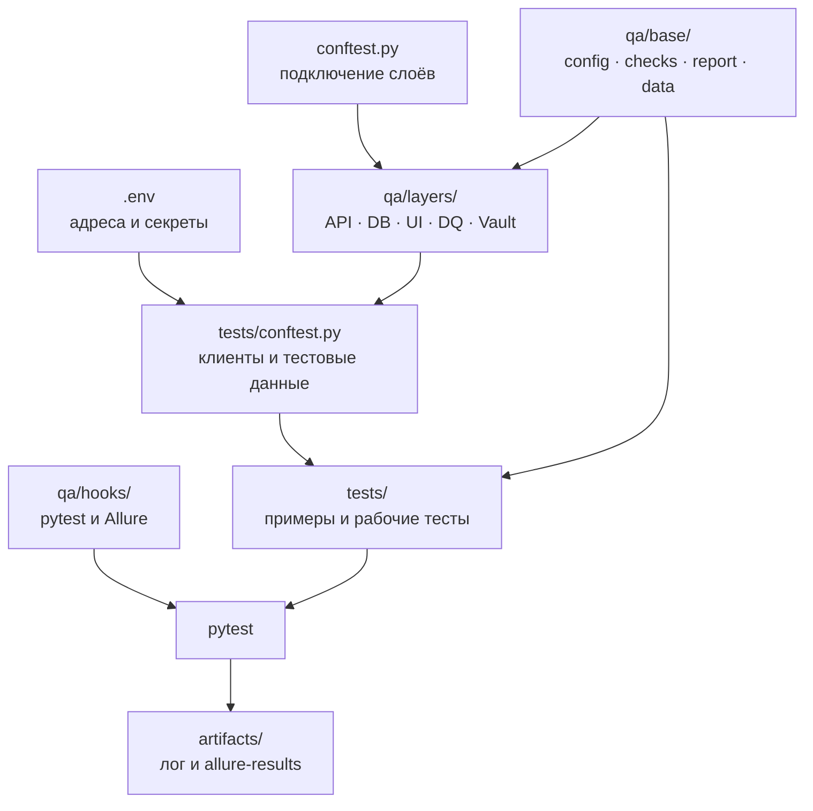

# qa-harness

Набор готовых компонентов и примеров для API, PostgreSQL, UI и Excel-тестов на pytest.

## Установка

Нужен Python 3.12+.

```bash
python -m venv .venv
source .venv/bin/activate                    # Windows: .venv\Scripts\activate
python -m pip install -r requirements/requirements.txt
python -m playwright install chromium       # только для UI
cp .env.example .env
```

Заполните `.env`. Секреты не добавляйте в Git.

## Настройка

Настройки разложены по назначению:

| Где | Что менять |
|---|---|
| `.env` | адреса, токены, логины, пароли, окружение |
| `conftest.py` | включённые слои `qa.layers.*` |
| `tests/conftest.py` | клиенты систем, авторизация, создание и удаление тестовых данных |
| `tests/<слой>/test_*.py` | URL методов, SQL, ожидаемые поля и бизнес-правила |
| `tests/ui/pages/` | локаторы и действия страниц |

Минимальный `.env`:

```dotenv
TEST_ENV=stage
SECRETS_SOURCE=env

STAGE_APP_API_URL=https://app-stage.example.com
STAGE_APP_API_TOKEN=
STAGE_APP_DB_HOST=
STAGE_APP_DB_PORT=5432
STAGE_APP_DB_NAME=
STAGE_APP_DB_USER=
STAGE_APP_DB_PASSWORD=
STAGE_APP_FRONTEND_URL=https://app-stage.example.com
STAGE_APP_FRONTEND_LOGIN=
STAGE_APP_FRONTEND_PASSWORD=
```

Полный список параметров находится в `.env.example`.

## Как всё связано



Структура файлов:

```text
qa/
├── base/                 общие настройки, проверки, отчёт, данные
├── hooks/                pytest-хуки
└── layers/               API, OData, DB, UI, DQ, Vault

tests/
├── conftest.py           фикстуры систем и тестовых данных
├── api/                  REST и OData
├── db/                   PostgreSQL
├── ui/                   Playwright и pages/
└── dq/                   Excel-отчёты

requirements/             профили зависимостей
```

## Запуск

```bash
python -m pytest --collect-only -q             # проверить сборку
python -m pytest                               # все тесты
python -m pytest tests/api                     # один слой
python -m pytest tests/api/test_api_order_create.py
python -m pytest -m "api or db"                # несколько слоёв
TEST_ENV=dev python -m pytest tests/db          # другое окружение
python -m pytest tests/ui --headed              # UI с окном
```

Результаты сохраняются в `artifacts/<дата>_<окружение>/`.

## Примеры

| Задача | Файл |
|---|---|
| REST API | `tests/api/test_api_crm_clients.py` |
| OData | `tests/api/test_api_odata_orders.py` |
| Создание и удаление через API | `tests/api/test_api_order_create.py` |
| PostgreSQL | `tests/db/test_db_orders.py` |
| UI | `tests/ui/test_ui_login.py`, `tests/ui/test_ui_projects.py` |
| Excel | `tests/dq/test_dq_orders_report.py` |

Новый тест кладите в папку его слоя. Тест должен создавать свои данные и удалять их через
фикстуру с `yield`. Проверки пишите внутри `with Checker() as checker:`.
